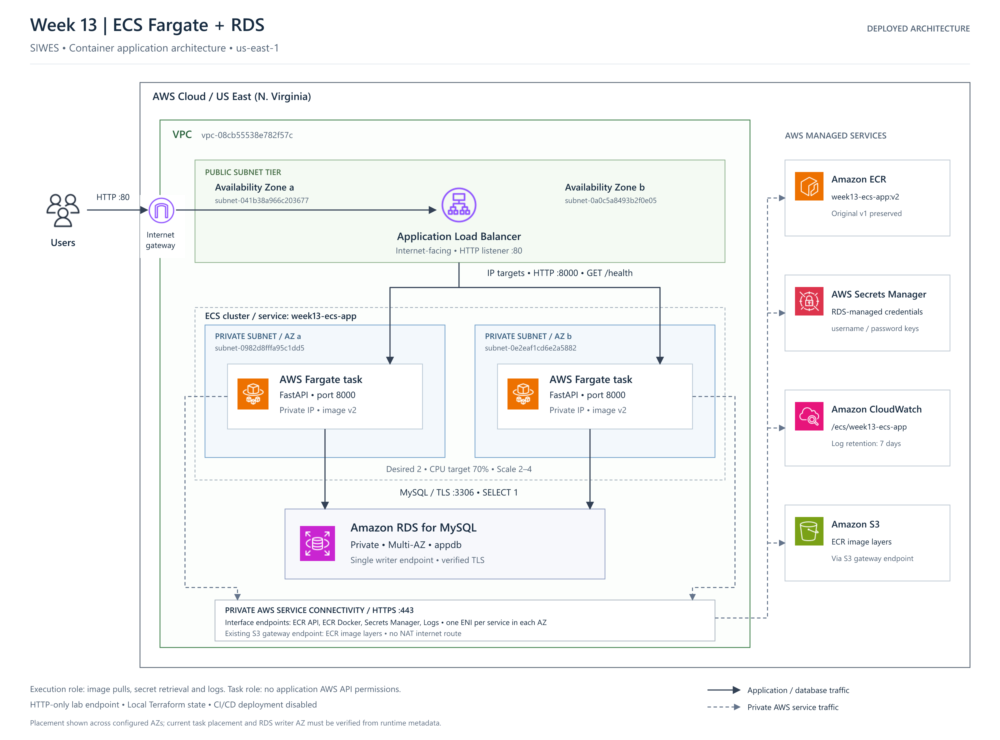

# SIWES Week 13: Terraform ECS Fargate and RDS

A deployed FastAPI application on two private Fargate tasks, served through an internet-facing Application Load Balancer and connected to private Multi-AZ MySQL. Covers labs **13.3–13.6**; CI workflow code is prepared, but cloud CI deployment and remote-state migration are **not enabled**.

## Deployment status and evidence

The owner confirmed two running ECS tasks, two healthy ALB targets, live `/health` reporting `database=connected`, and a Terraform plan with **No changes**. The local state records the deployed resources and the `v2` image reference. See [validation results](VALIDATION.md) for read-only checks performed during this documentation review; older preparation plans showing 21 additions are historical and must not be applied.

- Region: `us-east-1`; local-only AWS CLI profile: `siwes-terraform`.
- ECS cluster/service: `week13-ecs-app`.
- Image: `178777954852.dkr.ecr.us-east-1.amazonaws.com/week13-ecs-app:v2`; `v1` is preserved.
- Application: [ALB HTTP endpoint](http://week13-ecs-app-810464375.us-east-1.elb.amazonaws.com).
- RDS: `week13-mysql-db`, private MySQL, Multi-AZ; database `appdb`.
- Current backend: local Terraform state. S3 backend/OIDC bootstrap exists as source only.

### AWS Infrastructure Architecture


*Figure 1: Week 13 AWS infrastructure deployed using Terraform, featuring ECS Fargate, Application Load Balancer, private RDS MySQL Multi-AZ, Amazon ECR, CloudWatch, Secrets Manager, and VPC endpoints.*

[View alternative architecture diagram](docs/diagrams/week13-architecture-alternative.png) | [View Mermaid architecture source](docs/architecture.mmd)

<<<<<<< HEAD
=======
[High-resolution PNG](docs/assets/week13-architecture.png) · [Editable SVG](docs/assets/week13-architecture.svg)

```
>>>>>>> dd964df (docs: update Week 13 architecture and README)

The diagram shows the deployed data plane, not a deployed CI/backend system. It does not assign the RDS primary/standby to specific AZs. Both private subnets are configured for tasks; capture actual per-task AZ placement rather than inferring it from a task count. [Standalone Mermaid source](docs/architecture.mmd).

| Tier | Existing network placement |
|---|---|
| VPC | `vpc-08cb55538e782f57c` |
| Public ALB subnets | `subnet-041b38a966c203677` (a), `subnet-0a0c5a8493b2f0e05` (b) |
| Public route | `rtb-0592e21b8a7a8d2a6`: default route to `igw-07e65dd2cb923184a` |
| Private task/RDS subnets | `subnet-0982d8fffa95c1dd5` (a), `subnet-0e2eaf1cd6e2a5882` (b) |
| Private route tables | `rtb-078e4dfb83561e68f`, `rtb-027cf6be69569d7ff`: local and S3 routes; no NAT internet default route |
| Reused S3 gateway endpoint | `vpce-0329441a661f73268`, associated with both private route tables |

## Repository map

| Source | Purpose |
|---|---|
| `main.tf`, `security.tf`, `network.tf`, `ecr.tf` | Root wiring, existing resource ownership, security groups and private connectivity |
| `modules/ecs/` | Cluster, Fargate task/service, ALB/listener/IP target group, IAM, logs and autoscaling |
| `modules/rds/` | Existing private Multi-AZ MySQL and RDS-managed master secret |
| `app/` | FastAPI, Dockerfile, dependency constraints and local tests |
| `.github/workflows/`, `ci/` | Reviewed workflow and backend/OIDC bootstrap source; AWS-authenticated jobs disabled |
| `docs/` | [SIWES report](docs/SIWES_TECHNICAL_REPORT.md), [evidence checklist](docs/EVIDENCE_CHECKLIST.md), [Git and CI review](docs/GIT_AND_CI_REVIEW.md) |
| `evidence/` | Ignored local logs, plans and screenshots; never publish wholesale |

## How the application connects

ECS uses the execution role to read the existing RDS secret and inject its JSON keys as `DB_USERNAME` and `DB_PASSWORD`. `APP_ENV`, `DB_HOST`, `DB_PORT`, `DB_NAME` and `DB_SSL_CA` are ordinary task environment settings. Credentials are not written into the Docker image or Terraform variables. The task role has no application AWS API permissions because the app calls MySQL directly.

At startup, FastAPI retries `SELECT 1` using PyMySQL and a verified TLS connection. The RDS CA bundle is baked into the image. `/health` repeats a real query and returns HTTP 503 on failure without exposing exception details; healthy responses include `database=connected`. The ECS Python probe requires that field, not just HTTP 200. ALB checks `/health` on port 8000. Secret rotation does not update running task environment values; a separately approved task redeployment is needed afterward.

## Deployment procedure and change control

The deployment is complete. The following describes a future controlled change, not actions to perform during this documentation review.

1. Work in this folder and select the AWS profile/region below. Preserve the existing local state and provider lock file. Never initialize an empty replacement state for the live resources.
2. Compare source with the running version. For application changes, build a **new** image tag, run unit and local MySQL/TLS tests, and obtain explicit approval before any ECR push. Preserve `v1` and the deployed `v2`; do not reuse their tags.
3. Update the image reference only as an approved change. Run formatting, validation and a full plan. Review costs, IAM and every resource action. Obtain approval of the fresh plan before any apply. A no-change plan is expected for this completed configuration.
4. Apply only the approved saved plan during an authorized deployment window; verify task count/AZs/digest, target health, `/health`, logs and final drift plan. No apply or image push is performed as part of this documentation task.
5. Keep CI deployment disabled until its separate repository, backend, role and reviewer prerequisites are reviewed and approved. Local deployment success does not complete the live CI exercise in lab 13.6.

Preparation and read-only checks (PowerShell):

```powershell
Set-Location 'C:\Users\HP 840 G7\Documents\SIWES1-Terraform\week13-terraform-ecs-rds'
$env:AWS_PROFILE = 'siwes-terraform'
$env:AWS_REGION = 'us-east-1'
$env:AWS_PAGER = ''
terraform fmt -check -recursive
terraform validate -no-color
./scripts/check_state.ps1
terraform plan '-input=false' '-lock-timeout=60s' -detailed-exitcode -no-color
# Exit 0 = no changes; 2 = changes requiring review; 1 = failure.
```

Use `terraform init -lockfile=readonly` only when initializing this same configuration/backend; do not use `-upgrade`, `-migrate-state`, `state rm`, import or manual state edits to solve a routine validation problem. If starting a new checkout, first arrange authorized access to the existing state; never apply from an empty state.

## Verification and evidence capture

These operations read metadata or make an application GET request; they do not retrieve secret values:

```powershell
New-Item -ItemType Directory -Path evidence/screenshots -Force | Out-Null
$cluster = terraform output -raw ecs_cluster_name
$service = terraform output -raw ecs_service_name
$url = terraform output -raw application_url
$target = terraform output -raw target_group_arn
aws ecs describe-services --cluster $cluster --services $service --query 'services[0].{desired:desiredCount,running:runningCount,pending:pendingCount,status:status}' | Tee-Object evidence/service.json
$tasks = (aws ecs list-tasks --cluster $cluster --service-name $service --desired-status RUNNING --output json | ConvertFrom-Json).taskArns
aws ecs describe-tasks --cluster $cluster --tasks $tasks --query 'tasks[].{AZ:availabilityZone,status:lastStatus,health:healthStatus,digest:containers[0].imageDigest,network:attachments}' | Tee-Object evidence/tasks.json
aws elbv2 describe-target-health --target-group-arn $target | Tee-Object evidence/targets.json
$health = Invoke-RestMethod "$url/health"
$health | ConvertTo-Json | Tee-Object evidence/health.json
if ($health.database -ne 'connected') { throw 'Database probe did not pass' }
aws logs tail /ecs/week13-ecs-app --since 15m --format short
aws application-autoscaling describe-scalable-targets --service-namespace ecs --resource-ids "service/$cluster/$service"
aws application-autoscaling describe-scaling-policies --service-namespace ecs --resource-id "service/$cluster/$service"
```

Verify two running tasks, zero pending tasks, two healthy IP targets, correct task image digest and real database health. AZ placement and private addressing need task-network evidence. Configuration of 70% CPU does not prove a load-induced scale-out; do not claim a scaling test without an observed event. Use Windows **Win+Shift+S** for screenshots and save privately under `evidence/screenshots/`. Follow the [evidence checklist](docs/EVIDENCE_CHECKLIST.md); redact accounts, personal information and network details before public sharing, and never show secret values.

## Costs

Illustrative `us-east-1` estimate at 730 hours/month; this is not an account billing measurement:

| Component | Assumption | Monthly estimate |
|---|---|---:|
| Interface endpoints | 4 services × 2 AZs × $0.01/hour | $58.40 |
| Fargate, two tasks | Each 0.25 vCPU / 0.5 GiB; $0.04048/vCPU-hour and $0.004445/GiB-hour | $18.02 |
| ALB base | $0.0225/hour; excludes LCUs | $16.43 |
| ALB public IPv4 | Assumed two × $0.005/hour | $7.30 |
| **Container/network subtotal** | Before variable usage and existing data layer | **about $100.15** |

Four running tasks double the Fargate portion. Rolling deployments may temporarily run up to twice the desired task count. Add ALB LCUs, endpoint processing, logs, data transfer, ECR storage/scanning where applicable, RDS-managed Secrets Manager charges, and the **existing Multi-AZ RDS instance/storage**. The S3 gateway endpoint has no endpoint-hour charge. A future remote backend adds S3 storage/requests. No NAT gateway is provisioned. There is no free-tier assumption; resources accrue charges while idle.

Confirm current regional prices and actual usage using [PrivateLink pricing](https://aws.amazon.com/privatelink/pricing/), [Fargate pricing](https://aws.amazon.com/fargate/pricing/), [ALB pricing](https://aws.amazon.com/elasticloadbalancing/pricing/) and [public IPv4 pricing](https://aws.amazon.com/vpc/pricing/). Set a budget only through a separately approved account change.

## Security controls and current limitations

- Only ALB port 80 is internet-facing. The ALB SG reaches task port 8000; the task SG reaches RDS 3306, endpoint SG 443 and S3 regional prefix-list 443. Tasks have no public IP and no unrestricted internet egress. Endpoint policies use AWS defaults; scoped IAM provides an additional authorization boundary.
- The app runs nonroot with a read-only root filesystem. Execution permissions scope ECR, logs and the one RDS secret; wildcard ECR authorization-token access is required. Secrets are environment values inside the running process and remain accessible to sufficiently privileged runtime/debug tooling.
- **HTTP only:** no HTTPS listener, certificate or domain; no authentication, WAF or rate limiting is configured. Do not treat this training endpoint as suitable for sensitive public workloads.
- **Database privilege:** the app uses the RDS-managed master user. A least-privilege SQL application user and its own secret are a future approved database change.
- **Data protection:** source retains `backup_retention_period=0`, `deletion_protection=false`, `skip_final_snapshot=true`. Multi-AZ improves availability; it is not a backup. Terraform `prevent_destroy` on RDS/ECR does not protect against console/CLI deletion or deliberate removal of the guard. Production backup/deletion controls need a separate approval.
- ECR tags and Python dependency ranges are mutable; future supply-chain hardening should pin image digests/dependencies and review scan results. The image contains the CA bundle from build time; refresh it through reviewed rebuilds.
- A DB outage makes readiness fail and can trigger task replacement/rolling-deployment rollback. Startup retries are bounded; the app does not continuously refetch rotated secrets. Logs retain seven days; no project alerting, log archive, restore test or autoscaling load test is evidenced.
- State remains local and contains sensitive infrastructure metadata. Keep access restricted and maintain an approved protected backup. No manual state edits or new backend ownership changes are part of this work.

## Git and CI status

The folder inherits `C:/Users/HP 840 G7/.git` and the **portfolio** remote, not a dedicated Week 13 repository. No Git initialization, staging, commit, remote edit or push has been performed. [Git/CI review](docs/GIT_AND_CI_REVIEW.md) records ownership, workflow controls and the proposed repository isolation process.

The validation workflow is credential-free. PR AWS plans and the apply workflow are explicitly disabled with `if: ${{ false }}`; setting a repository variable alone cannot enable deployment. Their OIDC, environment and backend scaffolding is retained for future review. Remote state, exact-repository roles, protected GitHub Environments, required reviewers and branch protection must be set up and tested under a separate approval before enabling any cloud CI job. Action versions currently use release tags rather than immutable SHAs; pinning and policy review remain future work.

`.gitignore` excludes state/locks, plans/JSON exports, all real tfvars, backend files, credentials, secret/key material, evidence, generated documents/images and caches. [Sanitized variable example](terraform.tfvars.example) and provider `.terraform.lock.hcl` files remain publishable. Ignore rules do not remove secrets already tracked in a parent repository; inspect the exact candidate file list before any future staging. Never use `git add .` at the home Git root.

## Cleanup: separate approval required

Cleanup is **not performed**. Never run an unqualified root destroy: the state also owns the existing database, ECR and security groups. Preserve the VPC/subnets, RDS, ECR/v1/v2, existing S3 gateway endpoint, existing SGs and Terraform state unless their deletion is separately authorized.

1. Capture evidence and confirm retention/backup requirements. Keep CI cloud jobs disabled. Identify every new resource from state and its dependency graph.
2. For a separately authorized compute teardown, prepare a targeted **destroy plan only** for the new ECS/ALB/roles/logs/autoscaling/endpoints and their added rules:

```powershell
# FUTURE CLEANUP REVIEW ONLY. Do not run as part of documentation work.
terraform plan -destroy '-target=module.ecs' '-target=aws_vpc_endpoint.interface' '-target=aws_vpc_security_group_egress_rule.ecs_to_endpoints' '-target=aws_vpc_security_group_egress_rule.ecs_to_s3' '-target=aws_vpc_security_group_ingress_rule.endpoints_from_ecs' '-target=aws_security_group.endpoints' '-out=evidence/cleanup-review.tfplan'
terraform show -no-color evidence/cleanup-review.tfplan
```

3. Stop if existing RDS/ECR/VPC/subnets/S3 gateway/original SGs are listed for deletion or modification. Targeted planning is exceptional and incomplete by design; review all dependencies. Obtain explicit approval of the exact teardown plan before any apply. No cleanup apply command is automated here.
4. After approved teardown, independently confirm preserved resources and state ownership. Retain the state and any future backend while the database/registry remain managed. Do not delete provider lock files or state to suppress recreation plans. The unchanged source would recreate removed compute on a later apply; reconcile intended configuration under review.

Deleting only application tasks does not stop ALB/endpoint charges; compute-tier cleanup still leaves RDS/registry costs. Teardown deletes the configured log group, so retain approved evidence first.

## Supporting documents

- [SIWES technical report](docs/SIWES_TECHNICAL_REPORT.md)
- [Evidence checklist](docs/EVIDENCE_CHECKLIST.md)
- [Git ownership and workflow review](docs/GIT_AND_CI_REVIEW.md)
- [Current documentation validation](VALIDATION.md)
- [Historical image-preparation record](IMAGE_PREPARATION.md)

Technical references: [Fargate private connectivity](https://docs.aws.amazon.com/AmazonECS/latest/developerguide/vpc-endpoints.html), [ECS secret injection](https://docs.aws.amazon.com/AmazonECS/latest/developerguide/secrets-envvar-secrets-manager.html), [S3 backend locking](https://developer.hashicorp.com/terraform/language/backend/s3), [GitHub OIDC on AWS](https://docs.github.com/en/actions/how-tos/secure-your-work/security-harden-deployments/oidc-in-aws).
